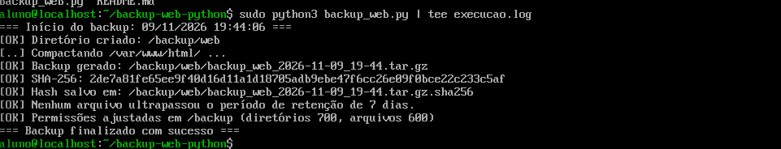
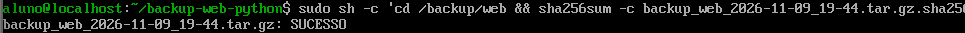
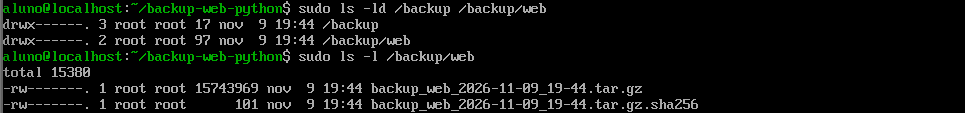

# Automação de Backup e Retenção com Python

Script em Python para automatizar o backup do servidor web (`/var/www/html/`) em ambiente **Fedora / RHEL**, com checksum, política de retenção e permissões restritas.

> Atividade prática — Prof. Denilson Bonatti

## O que o script faz

1. Cria o diretório `/backup/web/` caso não exista.
2. Gera `backup_web_AAAA-MM-DD_HH-MM.tar.gz` com todo o conteúdo de `/var/www/html/`.
3. **[Extra]** Calcula o SHA-256 e salva em `backup_web_AAAA-MM-DD_HH-MM.tar.gz.sha256`.
4. Remove backups `.tar.gz` com mais de **7 dias** (e o `.sha256` correspondente), informando o que foi removido.
5. **[Extra]** Ajusta permissões em `/backup/`: **700** nos diretórios e **600** nos arquivos.

## Requisitos

- Fedora / RHEL (ou derivados)
- Python 3 (somente bibliotecas padrão: `os`, `tarfile`, `hashlib`, `time`, `datetime`)
- Privilégios de superusuário

## Como usar

```bash
git clone https://github.com/SEU_USUARIO/SEU_REPOSITORIO.git
cd SEU_REPOSITORIO
sudo python3 backup_web.py
```

### Verificar a integridade de um backup

```bash
cd /backup/web
sudo sha256sum -c backup_web_AAAA-MM-DD_HH-MM.tar.gz.sha256
```

### Agendar execução diária (opcional)

```bash
sudo crontab -e
# todo dia às 02:00
0 2 * * * /usr/bin/python3 /caminho/backup_web.py >> /var/log/backup_web.log 2>&1
```

## Evidências de execução

> Substitua pelos seus prints/logs reais (salve as imagens na pasta `prints/`).

### 1. Execução do script
```
COLE AQUI A SAÍDA DO TERMINAL
```


### 2. Arquivos gerados em /backup/web/
```
ls -la /backup/web/
```


### 3. Validação do checksum
```
sha256sum -c ...
```


### 4. Permissões
```
ls -ld /backup /backup/web ; ls -l /backup/web
```


## Autor

Kayky — Sistemas de Informação
